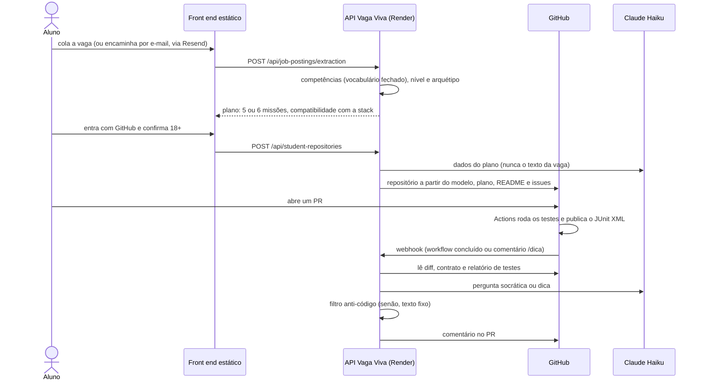
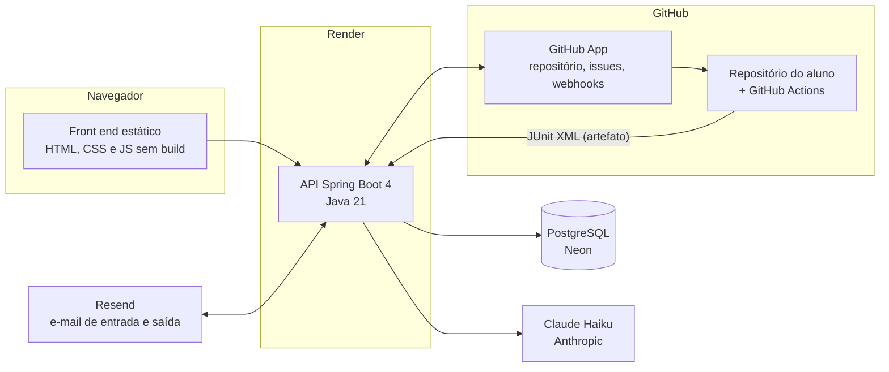

# Vaga Viva

Aprender fazendo com vagas reais, com um revisor que não dá a resposta.

Projeto da trilha **Acesso à educação** do Hack Brasil 2026.

## O que é

O aluno cola o texto (ou o link) de uma vaga real, ou encaminha a vaga por e-mail para **`vagas@bueska.resend.app`**, e recebe no próprio GitHub um projeto de estudo montado para ela:

- um **README** que liga o projeto ao nível e às competências da vaga;
- **uma issue por missão**, na ordem do plano;
- **testes que falham** até o aluno implementar cada missão.

Quando o aluno abre um PR, um **revisor socrático** comenta: faz perguntas sobre o teste que falha e o contrato da missão, sem nunca entregar código. Se travar, o aluno comenta `/dica` e recebe dicas em **3 níveis**, cada vez mais concretas, ainda sem código. Quem decide se a missão está pronta são os testes, não o LLM.

No **modo turma**, o professor cria uma turma a partir de uma vaga-base, compartilha um link de convite e acompanha num painel a missão de cada aluno, quem está travado e os testes que falham. Toda segunda, se pediu, recebe um resumo por e-mail. O aluno também pode pedir, para si, um e-mail semanal com a missão da semana.

## Como avaliar

A demo está em **<https://vaga-viva-49kj.onrender.com>**. Se ela estiver parada, a primeira página pode levar até um minuto para abrir.

| Passo | O que fazer | O que observar |
| --- | --- | --- |
| 1. Vaga → plano, sem login | Abra a demo, clique em **Usar uma vaga de exemplo** e depois em **Montar meu plano**. Também dá para colar uma vaga real: uma de FastAPI recebe o projeto em Python, e uma de NestJS, o projeto em TypeScript. | As competências marcadas no texto da vaga, o nível, as 5 ou 6 missões e o aviso de cobertura da stack. |
| 2. Plano → repositório | Marque **Tenho 18 anos ou mais** e clique em **Criar meu repositório no GitHub**. Entre com o GitHub e autorize a instalação do app Vaga Viva na sua conta. | O repositório no seu GitHub, com o README sobre a vaga, uma issue por missão (cada uma com o link para o contrato) e os testes vermelhos no Actions. |
| 3. O revisor, sem precisar programar | Abra o PR de exemplo [davsilvam/vaga-viva-clinic-scheduling#7](https://github.com/davsilvam/vaga-viva-clinic-scheduling/pull/7). | Cada push recebe uma revisão nova, com a anterior encolhida: progresso por missão, testes que falham, perguntas, e as dicas do `/dica` em 3 níveis. Nenhuma linha de código da solução. |
| 4. O revisor no seu repositório | No repositório do passo 2, abra um PR com qualquer mudança. Espere o workflow **Vaga Viva** terminar e comente `/dica`. | A revisão chega no PR e por e-mail, como notificação do GitHub. Cada `/dica` aprofunda a anterior. |
| 5. Vaga por e-mail | Encaminhe uma vaga para `vagas@bueska.resend.app`. | Em segundos, chega a resposta com o plano e um link que abre a página já preenchida. |
| 6. Modo turma | Só professores autorizados criam turmas. Para testar, abra uma issue neste repositório com o seu login do GitHub, e o time libera o acesso. | A turma com link de convite, o painel com a missão de cada aluno e a ficha com os testes que falham e a última pergunta do revisor. |

Depois de avaliar, você pode apagar o repositório criado e remover o app em **GitHub → Settings → Applications**.

## Como funciona



1. **Vaga → plano.** As competências são reconhecidas num vocabulário fechado (ESCO mais uma lista própria), o nível vem de regras, e o arquétipo sai das linguagens e frameworks citados. A escolha e a ordem das missões são determinísticas.
2. **Plano → repositório.** O GitHub App cria o repositório do aluno a partir do repositório-modelo do arquétipo, grava `.vaga-viva/plan.json`, escreve o README e abre uma issue por missão. Os testes das missões fora do plano ficam desligados.
3. **PR → revisão.** O workflow do repositório do aluno roda os testes e sobe o relatório JUnit XML como artefato. O webhook avisa a API, que lê o relatório, o diff e o contrato da missão em foco, e responde no PR.

## Arquitetura



| Peça | Papel |
| --- | --- |
| API (Spring Boot 4.1, Java 21) no Render | Extração da vaga, plano, criação do repositório, revisor, dicas, modo turma e e-mails. Publicada pelo CI a cada push no `main` que passa nos testes. |
| PostgreSQL 17 no Neon | Só turmas, matrículas, progresso e inscrições no e-mail semanal. Migrações com Flyway. |
| GitHub App | Cria o repositório a partir do modelo, grava o plano, abre as issues e recebe os webhooks de fim de workflow e de comentários `/dica`. Login do aluno por OAuth. |
| GitHub Actions (no repositório do aluno) | Roda os testes e publica o relatório JUnit XML que o revisor lê. |
| Claude Haiku (`claude-haiku-5-5`) | Redige o README, o contexto das missões, as perguntas do revisor e as dicas. Toda resposta passa pelo filtro anti-código; recusada ou indisponível, vale um texto fixo. Sem `ANTHROPIC_API_KEY`, tudo funciona com os textos fixos. |
| Firecrawl | Lê a página de carreira quando ela é montada por JavaScript ou recusa o download do app. Só entra quando o leitor do próprio app não acha o texto da vaga. Sem `FIRECRAWL_API_KEY`, essas páginas pedem que o aluno cole o texto. Portais testados em [`docs/portais-de-vaga.md`](docs/portais-de-vaga.md). |
| Resend | Recebe vagas encaminhadas por e-mail e envia a resposta com o plano, o e-mail semanal do aluno e o resumo do professor. |
| Front end | Páginas estáticas em `src/main/resources/static`, servidas pela própria API. A página do projeto fica em `site/` (GitHub Pages). |

### Pacotes

Em `src/main/java/io/github/precavidos/vagaviva/`:

| Pacote | O que faz |
| --- | --- |
| `jobposting` | Recebe o texto da vaga ou lê a página de um link (com bloqueio de endereços internos e limite de leituras) e detecta o nível. |
| `vocabulary` | Vocabulário fechado de competências e tecnologias; reconhece termos sem confundir "Java" com "JavaScript". |
| `archetype` | Catálogo de arquétipos e cálculo da compatibilidade com a stack da vaga. |
| `plan` | Catálogo de missões e regras determinísticas que montam o plano. |
| `writing` | Textos do README e das missões pelo Claude, com textos padrão de reserva. |
| `provisioning` | Cria o repositório do aluno, grava o plano, o README e as issues; exige a confirmação de 18+. |
| `review` | Webhooks, leitura do relatório JUnit, revisor socrático, dicas em 3 níveis e o filtro anti-código. |
| `classroom` | Turmas, convites, matrícula com consentimento, progresso, painel e resumo semanal do professor. |
| `email` | Vagas recebidas por e-mail (webhook assinado do Resend), e-mail semanal e descadastro. |
| `login` | Segurança: login com GitHub por OAuth, sessão em memória, CSRF. |
| `webhook` | Limite de tamanho do corpo dos webhooks. |
| `github` | Cliente da API do GitHub. |
| `database` | Converte as URLs do Neon para o formato JDBC. |

## Arquétipos

Os três arquétipos do MVP estão no ar, com o mesmo domínio fictício (agendamento de clínica) e as mesmas 11 missões, de `patients-api` a `api-security`.

| Arquétipo | Stack | Repositório-modelo | Missões | Testes de uma missão |
| --- | --- | --- | --- | --- |
| `java-spring` | Java e Spring Boot | [`precavidos/vaga-viva-template-java-spring`](https://github.com/precavidos/vaga-viva-template-java-spring) | [`java-spring.json`](src/main/resources/missions/java-spring.json) | `./mvnw test -Dgroups=<missão>` |
| `typescript-node` | TypeScript e NestJS | [`precavidos/vaga-viva-template-typescript-node`](https://github.com/precavidos/vaga-viva-template-typescript-node) | [`typescript-node.json`](src/main/resources/missions/typescript-node.json) | `npm test -- missions/<missão>` |
| `python-fastapi` | Python e FastAPI | [`precavidos/vaga-viva-template-python-fastapi`](https://github.com/precavidos/vaga-viva-template-python-fastapi) | [`python-fastapi.json`](src/main/resources/missions/python-fastapi.json) | `uv run pytest --mission <missão>` |

Cada modelo tem uma solução de referência num repositório privado (`*-solution`, um commit por missão). O script `scripts/validate.sh` da solução confere que os testes de cada missão falham no modelo (por asserção, com mensagem em português), passam na solução e passam com só as missões centrais e a própria aplicadas, e que o `plan.json` desliga as demais. Ele imprime uma tabela missão × resultado. Uma missão só entra num plano depois de validada. Os critérios estão nos briefings em [`docs/devin/`](docs/devin/).

O catálogo de arquétipos e das tecnologias reconhecidas fica em [`archetypes/catalog.json`](src/main/resources/archetypes/catalog.json). Uma vaga que cita uma stack sem arquétipo (Go, por exemplo) recebe o projeto do arquétipo padrão, com o aviso do que ele não pratica.

## Decisões técnicas

| ADR | Decisão |
| --- | --- |
| [0001](docs/adr/0001-vocabulario-fechado-de-competencias.md) | Competências mapeadas num vocabulário fechado (ESCO mais uma lista própria), não em texto livre: a mesma vaga gera sempre as mesmas competências, e a precisão é mensurável. |
| [0002](docs/adr/0002-logica-deterministica-llm-so-explica.md) | Regras escolhem e ordenam as missões; o LLM só redige. O plano é reproduzível, o custo previsível, e uma queda do LLM não impede a entrega. |
| [0003](docs/adr/0003-privacidade-da-vaga.md) | O texto da vaga fica só em memória; do aluno, o mínimo, com consentimento, e o descadastro apaga. |
| [0004](docs/adr/0004-um-dominio-ficticio-por-arquetipo.md) | Um domínio fictício fixo por arquétipo: um modelo, uma suíte de testes e uma solução de referência para validar. |
| [0005](docs/adr/0005-plano-no-repositorio-do-aluno.md) | O plano vai em `.vaga-viva/plan.json` no repositório do aluno, e os testes marcados por missão fora do plano ficam desligados. |
| [0006](docs/adr/0006-escolha-do-arquetipo-e-compatibilidade.md) | O arquétipo sai das linguagens e frameworks da vaga, por regras fixas, e o aluno vê o quanto o projeto cobre a stack (`COVERED`, `PARTIAL`, `NOT_COVERED`, `NOT_STATED`). |
| [0007](docs/adr/0007-progresso-do-aluno-em-turma.md) | No modo turma, o progresso é gravado a cada evento, só de quem entrou e consentiu; o painel só lê o banco. |

O glossário do domínio está em [`CONTEXT.md`](CONTEXT.md). Specs e planos já executados ficam em [`docs/historic/`](docs/historic/).

## Privacidade e LGPD

O princípio é guardar o mínimo, e só com consentimento ([ADR 0003](docs/adr/0003-privacidade-da-vaga.md) e [ADR 0007](docs/adr/0007-progresso-do-aluno-em-turma.md)). Vagas podem trazer nomes e contatos de recrutadores, então o texto da vaga nunca é gravado.

### O que não é guardado

- **O texto da vaga**, colado, lido de um link ou encaminhado por e-mail: é processado em memória e descartado. Ficam só os ids das competências, das tecnologias, do nível e do arquétipo. Do e-mail encaminhado, nem remetente, nem assunto, nem corpo são gravados ou vão para o log.
- **O código do aluno**: fica no GitHub dele; a API lê o diff do PR para a revisão e não o grava.
- **O token do GitHub do aluno**: fica na sessão HTTP, em memória, não no banco.

### O que é guardado, e quando

| Situação | Dados | Como sai |
| --- | --- | --- |
| Uso individual | Nada no banco. | — |
| E-mail semanal (checkbox opcional) | Login do GitHub, e-mail, repositório, data do consentimento, token de descadastro, data do último envio. | O link de descadastro apaga a linha. |
| Aluno em turma (consentimento na matrícula) | Nome escolhido para o painel, login do GitHub, repositório, missão atual e desde quando, números dos PRs, testes que falham com as mensagens filtradas e a contagem de testes por missão, última pergunta do revisor, link do último PR, dicas por missão. | Exclusão manual no piloto, a pedido do aluno ou do professor ([`docs/deploy.md`](docs/deploy.md)). |
| Professor | Login do GitHub e, se consentir, e-mail e data do consentimento. | Exclusão manual no piloto. |

Os logs não trazem e-mails, nomes, texto de vaga nem código: citam no máximo o repositório e o número do PR, o login do GitHub do aluno (no e-mail semanal) ou o id da turma.

### Idade

O Vaga Viva é para **maiores de 18 anos**: toda rota que cria um repositório exige que o aluno confirme isso. Atender menores traz as obrigações do ECA Digital (Lei 15.211/2025), que estão no roteiro e ainda não foram construídas.

### Terceiros fora do Brasil

| Serviço | O que recebe |
| --- | --- |
| Anthropic (Claude) | Os dados do plano (arquétipo, nível, competências, tecnologias e missões), nunca o texto da vaga. Na revisão e nas dicas: o diff do PR, o contrato da missão, os nomes e as mensagens dos testes que falham e os comentários anteriores do próprio app. Nenhum e-mail ou nome. |
| Firecrawl | Só o link público da página de vaga, quando o leitor do próprio app não consegue lê-la. Nada sobre o aluno. |
| Resend | O e-mail encaminhado pelo aluno (com a vaga) e os e-mails enviados: endereço do destinatário e conteúdo, que no resumo do professor inclui os nomes escolhidos pelos alunos. |
| Render | Hospeda a API; todas as requisições passam por ele. Região nos EUA, a mesma do banco. |
| Neon | Hospeda o banco com os dados da tabela acima, em `AWS us-east-1`. |
| GitHub | O repositório do aluno, as issues e os comentários do app, na conta do próprio aluno. |

> Este é um resumo técnico do que o código faz, não uma avaliação jurídica nem aconselhamento legal.

## Como rodar localmente

Requisitos: Java 21 e Docker.

```bash
docker compose up -d     # PostgreSQL 17 local (compose.yaml)
./mvnw spring-boot:run   # API e front end em http://localhost:8080
```

As tabelas são criadas pelo Flyway na primeira subida. Sem nenhuma variável, a API sobe contra o banco do `compose.yaml`, extrai vagas e monta planos com os textos padrão.

Para ligar o resto, copie `.env.example` para `.env`, preencha só o que precisar e carregue antes de subir (o Spring não lê o `.env` sozinho):

```bash
set -a; . ./.env; set +a; ./mvnw spring-boot:run
```

| Variáveis | Para quê | Vazias |
| --- | --- | --- |
| `GITHUB_CLIENT_ID`, `GITHUB_CLIENT_SECRET` | Login com GitHub | Sem login, sem criação de repositório |
| `GITHUB_APP_ID`, `GITHUB_APP_PRIVATE_KEY`, `GITHUB_WEBHOOK_SECRET` | GitHub App: repositório, webhooks, revisor e dicas | Webhook desligado |
| `ANTHROPIC_API_KEY` | Textos do Claude | Textos padrão |
| `FIRECRAWL_API_KEY` | Leitura de páginas montadas por JavaScript | Essas páginas pedem o texto colado |
| `RESEND_API_KEY`, `RESEND_WEBHOOK_SECRET`, `RESEND_FROM`, `VAGAVIVA_PUBLIC_URL` | Vaga por e-mail e envios | Endpoints de e-mail respondem 503 |
| `WEEKLY_EMAIL_SECRET` | Disparo do e-mail semanal | Endpoint responde 503 |
| `CLASSROOM_TEACHERS`, `CLASSROOM_SUMMARY_SECRET` | Modo turma (logins dos professores) e resumo semanal | Ninguém cria turma; resumo responde 404 |
| `DATABASE_URL`, `DATABASE_URL_UNPOOLED` | Banco no Neon (`neon env pull`) | Banco local do `compose.yaml` |

A configuração do GitHub App está em [`docs/github-app.md`](docs/github-app.md); a publicação no Render, no Neon e no Resend, em [`docs/deploy.md`](docs/deploy.md). A demo pública roda no Render, e a URL atual fica no ambiente `production` do repositório no GitHub.

## Testes e qualidade

```bash
./mvnw verify
```

- Os testes de integração sobem um PostgreSQL de verdade com **Testcontainers** (precisa do Docker).
- O CI (`.github/workflows/ci.yml`) roda os testes em cada PR e push no `main`, e só publica no Render se passar.
- A [bateria do revisor](docs/bateria-revisor.md) tenta fazer o revisor e o `/dica` entregarem a solução, em 10 casos com PRs reais: injeções no diff, no contrato da missão, nos nomes e nas mensagens dos testes. A rodada sem LLM achou um vazamento por eco (corrigido, com testes); a rodada com LLM, com os mesmos casos, não achou vazamento e está no mesmo documento.
- As páginas passaram por uma auditoria de acessibilidade com axe ([`docs/design/auditoria-axe.md`](docs/design/auditoria-axe.md)).

## Próximos passos

- **Avisar de vagas novas:** o app já lê páginas de carreira montadas por JavaScript com o Firecrawl. O próximo passo é o aluno escolher as empresas que quer seguir, e o Vaga Viva avisar quando aparece uma vaga nova na página de carreira delas.
- **Lembretes e avisos por WhatsApp, com a Nvoip:** o lembrete semanal e o aviso de vaga nova chegam também pelo WhatsApp, onde o aluno está. A API da Nvoip envia modelos de mensagem aprovados pela Meta. Para isso, o app passa a guardar o telefone do aluno, com consentimento e descadastro, como já faz com o e-mail.

## Licença

[MIT](LICENSE).

O vocabulário de competências usa a classificação [ESCO](https://esco.ec.europa.eu) (European Skills, Competences, Qualifications and Occupations), © União Europeia, reutilizada sob a licença [CC BY 4.0](https://creativecommons.org/licenses/by/4.0/). Os rótulos ESCO vêm da API oficial e podem ser conferidos com `python scripts/esco/refresh_labels.py <arquivo>`.

## Time

- [@davsilvam](https://github.com/davsilvam)
- [@Guiezz](https://github.com/Guiezz)
